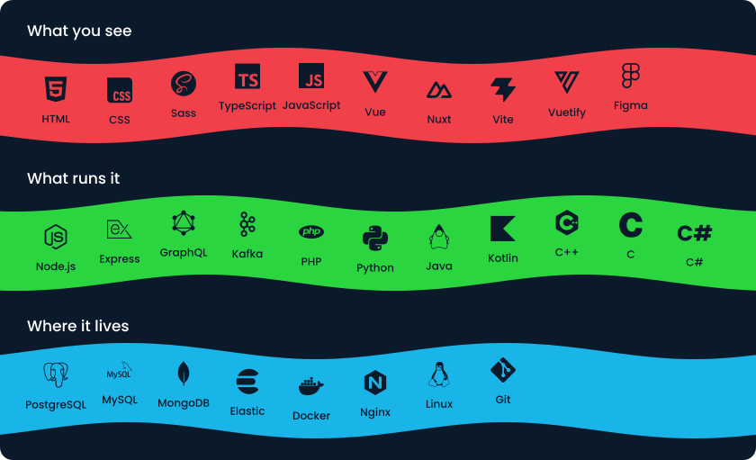

  

I'm an engineering student at **ENSSAT**, working as a fullstack developer in **work-study**. I enjoy building clean web apps, from the API to the last pixel.

I'm currently exploring **Kotlin / Jetpack Compose** and low-level **C++**. My daily driver is Linux (Fedora), tuned through my dotfiles.

## Tech stack

  

## Featured projects

  

  

## GitHub stats

  
  

## Let's connect

[LinkedIn](https://www.linkedin.com/in/mateo-guezennec/) · [mat.guezen@gmail.com](mailto:mat.guezen@gmail.com) · Discord: `blasterwhite`
